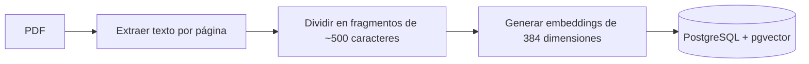
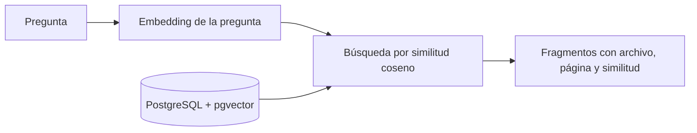

# docs-vector-db

> Subir pdfs y hacer consultas naturales.

<!-- AGREGAR: captura de pantalla principal de la interfaz -->
<!--  -->

Evolución de [dogs-vector-db](https://github.com/CORSbsk/dogs-vector-db): el mismo concepto de base de datos vectorial, pero en lugar de imágenes de perros, ahora trabaja con **documentos**.

**SERVICIO SOCIAL ITC CULIACAN**

---

## Índice

1. [Lenguaje Natural](#1-lenguaje-natural)
2. [Idea](#2-idea)
3. [Conceptos clave en 30 segundos](#3-conceptos-clave-en-30-segundos)
4. [Cómo funciona](#4-cómo-funciona)
5. [Demo](#5-demo)
6. [Tecnologías](#6-tecnologías)
7. [Estructura del proyecto](#7-estructura-del-proyecto)
8. [Cómo ejecutarlo](#8-cómo-ejecutarlo)
9. [Cómo se usa](#9-cómo-se-usa)
10. [Decisiones de diseño](#10-decisiones-de-diseño)
11. [Limitaciones conocidas](#11-limitaciones-conocidas)
12. [Estado y siguientes pasos](#12-estado-y-siguientes-pasos)
13. [Solución de problemas](#13-solución-de-problemas)
14. [Preguntas:](#14-preguntas:)

---

## 1. Lenguaje Natural

Buscar por **significado** y no por palabras exactas. Cada fragmento de texto se convierte en una lista de números (un *embedding*) que representa su sentido. Tu pregunta se convierte igual, y se devuelven los fragmentos cuyos números se parecen más a los de la pregunta.

## 2.- Idea

Crear una base de datos vectorizada donde puedas subir pdfs.

## 3. Conceptos clave en 30 segundos

| Concepto | Qué es | Analogía |
|---|---|---|
| **Embedding** | Lista de 384 números que representa el significado de un texto | Las coordenadas de una frase en un mapa de ideas |
| **Fragmento (chunk)** | Trozo de ~500 caracteres en que se divide cada documento | Una ficha de estudio |
| **Similitud coseno** | Qué tan parecidos son dos embeddings (de 0 a 1) | Qué tan cerca están dos puntos del mapa |
| **pgvector** | Extensión de PostgreSQL que guarda y compara embeddings | Un buscador de "puntos cercanos" dentro de la base de datos |

## 4. Cómo funciona

**Cuando subes un PDF (ingesta):**



**Cuando haces una pregunta (búsqueda):**



Lo importante: la pregunta y los documentos se convierten **con el mismo modelo**, por eso se pueden comparar.

## 5. Demo

<!-- AGREGAR: captura o GIF subiendo un PDF -->
<!-- AGREGAR: captura o GIF haciendo una pregunta y viendo los resultados -->

**Qué se puede hacer hoy desde la interfaz:**

- Subir uno o varios PDFs (se detectan duplicados automáticamente)
- Ver la lista de documentos cargados y eliminarlos
- Hacer preguntas en lenguaje natural
- Ver cada resultado con su archivo, página y porcentaje de similitud
- Cambiar entre tema claro y oscuro

## 6. Tecnologías

| Parte | Tecnología | Para qué |
|---|---|---|
| Base de datos | PostgreSQL 16 + pgvector | Guardar texto, metadatos y vectores; búsqueda por similitud |
| Contenedor | Docker Compose | Levantar la base de datos sin instalar nada |
| Embeddings | sentence-transformers, modelo `paraphrase-multilingual-MiniLM-L12-v2` | Convertir texto en vectores de 384 dimensiones (multilingüe) |
| Lectura de PDFs | PyMuPDF | Extraer el texto de cada página y renderizar vistas previas |
| API | FastAPI + Uvicorn | Exponer búsqueda, subida y gestión de documentos |
| Interfaz | HTML + JavaScript + Tailwind CSS + daisyUI | Página con estilo de chat |

## 7. Estructura del proyecto

```
docs-vector-db/
├── python/
│   ├── api.py            API FastAPI y servidor de la interfaz
│   ├── chunker.py        Divide el texto en fragmentos con traslape
│   ├── db.py             Conexión a PostgreSQL
│   ├── embeddings.py     Carga el modelo y genera embeddings
│   ├── extractors.py     Extrae el texto de los PDFs
│   ├── ingest.py         Flujo completo: extraer, dividir, vectorizar, guardar
│   ├── init_db.py        Crea las tablas
│   ├── search.py         Búsqueda semántica (también usable por consola)
│   ├── storage.py        Guarda los PDFs originales y renderiza páginas
│   ├── static/
│   │   ├── index.html    Estructura de la página
│   │   ├── style.css     Personalización visual
│   │   └── app.js        Lógica de la interfaz
│   └── test_*.py         Scripts de prueba de cada pieza
├── sql/
│   └── init.sql          Esquema de la base de datos
├── data/                 PDFs de prueba (no se sube a Git)
├── storage/              PDFs originales y caché de imágenes (no se sube a Git)
├── docker-compose.yml    Base de datos con pgvector
└── requirements.txt      Dependencias de Python
```

**Base de datos (dos tablas):**

| Tabla | Contenido |
|---|---|
| `documents` | Un registro por archivo: nombre, tipo, hash para detectar duplicados, fecha |
| `chunks` | Un registro por fragmento: texto, página(s) de origen, embedding de 384 dimensiones |

## 8. Cómo ejecutarlo

### Requisitos

- [Python](https://www.python.org/downloads/) 3.10 o superior
- [Docker Desktop](https://www.docker.com/products/docker-desktop/) (debe estar **abierto y corriendo**)
- [Git](https://git-scm.com/)

### Instalación

```powershell
# 1. Clonar el repositorio
git clone https://github.com/CORSbsk/docs-vector-db.git
cd docs-vector-db

# 2. Crear y activar el entorno virtual
python -m venv venv
.\venv\Scripts\Activate.ps1          # Windows (PowerShell)
# source venv/bin/activate           # Linux / macOS

# 3. Instalar dependencias
pip install -r requirements.txt

# 4. Levantar la base de datos
docker compose up -d

# 5. Crear las tablas (solo la primera vez)
python python/init_db.py
```

La primera vez que se use, se descargará el modelo de embeddings (~450 MB). Después queda guardado en tu equipo.

### Arrancar la aplicación

Con el entorno virtual activo y Docker corriendo:

```powershell
uvicorn api:app --reload --reload-dir python --app-dir python
```

Abre **http://127.0.0.1:8000** en el navegador.

### Detener todo

```powershell
# Detener el servidor: Ctrl + C en la terminal
docker compose down          # apaga la base de datos
```

## 9. Cómo se usa

### Desde la interfaz web

1. Abre http://127.0.0.1:8000
2. Pulsa **Subir PDF** en la barra lateral y elige uno o varios archivos
3. Escribe una pregunta en la barra inferior, por ejemplo: *¿Qué es la Web 1.0?*
4. Revisa los fragmentos devueltos: cada uno indica el archivo, la página y qué tan parecido es a tu pregunta

### Desde la terminal

```powershell
# Subir un PDF (o una carpeta con PDFs)
python python/ingest.py data/mi_archivo.pdf

# Buscar de forma interactiva
python python/search.py
```

### API

La documentación interactiva está en **http://127.0.0.1:8000/docs**.

| Método | Ruta | Qué hace |
|---|---|---|
| `POST` | `/api/search` | Busca fragmentos relevantes (`query`, `k`, `min_similarity`) |
| `GET` | `/api/documents` | Lista los documentos y su número de fragmentos |
| `POST` | `/api/upload` | Sube y procesa un PDF |
| `DELETE` | `/api/documents/{id}` | Elimina un documento y sus fragmentos |
| `GET` | `/api/documents/{id}/page/{n}` | Devuelve la página `n` como imagen PNG |
| `GET` | `/api/documents/{id}/file` | Devuelve el PDF original |

### Consultar la base de datos directamente

```powershell
docker exec -it docs-vector-db psql -U postgres -d docs
```

```sql
SELECT id, filename, uploaded_at FROM documents;
SELECT chunk_index, metadata, left(content, 60) FROM chunks LIMIT 5;
```

## 10. Decisiones de diseño

| Decisión | Motivo |
|---|---|
| Modelo multilingüe `paraphrase-multilingual-MiniLM-L12-v2` | Los documentos están en español; es ligero y corre en CPU sin tarjeta gráfica |
| Embeddings normalizados + distancia coseno | Compara el sentido del texto sin que influya su longitud |
| Índice HNSW en pgvector | Búsqueda aproximada rápida aunque crezca la cantidad de fragmentos |
| Fragmentos de 500 caracteres con traslape de 100 | Se probó con 300 y con 500; 500 dio mejores resultados en PDFs de diapositivas. El traslape evita perder ideas cortadas entre dos fragmentos |
| Cortes en párrafo u oración | Evita fragmentos cortados a media frase o a media palabra |
| PyMuPDF en lugar de pypdf | Separa mejor las palabras (pypdf devolvía palabras pegadas) |
| Hash SHA-256 por archivo | Detecta PDFs repetidos aunque cambien de nombre |
| Ingesta en una sola transacción | Si algo falla, no quedan documentos a medias en la base de datos |
| Datos y vectores en PostgreSQL | Un solo sistema en lugar de una base de datos vectorial aparte |
| Guardar el PDF original con su hash como nombre | Permite generar vistas previas de páginas sin cambiar el esquema |
| FastAPI + HTML propio | Control total del diseño y backend reutilizable por otras interfaces |

## 11. Limitaciones conocidas

- **Solo PDFs con texto seleccionable.** Los PDFs escaneados (imágenes) no se pueden leer porque no hay OCR.
- **Devuelve fragmentos, no respuestas redactadas.** Es un buscador con formato de conversación; no hay un modelo de lenguaje que redacte la respuesta.
- **Uso local.** No tiene autenticación y las credenciales de la base de datos son las de desarrollo.
- **Los PDFs de diapositivas dan texto ruidoso.** Los títulos sueltos y los diagramas pueden aparecer como resultados poco útiles.

## 12. Estado y siguientes pasos

El avance se lleva en el [tablero del proyecto](https://github.com/CORSbsk/docs-vector-db/issues).

## 13. Solución de problemas

| Problema | Causa y solución |
|---|---|
| `connection refused` al puerto 5433 | Docker no está corriendo. Abre Docker Desktop y ejecuta `docker compose up -d` |
| PowerShell no deja activar el entorno virtual | Ejecuta una vez `Set-ExecutionPolicy -Scope CurrentUser RemoteSigned` |
| Un PDF se sube pero dice "no se pudo extraer texto" | Probablemente es un escaneo. Prueba con un PDF donde puedas seleccionar el texto con el cursor |
| La vista previa de un documento antiguo da error 404 | Se subió antes de guardar los originales. Elimínalo y vuelve a subirlo |
| Los cambios en `static/` no se ven | Recarga con `Ctrl + F5` para saltarte la caché del navegador |

## 14. Preguntas:

- *¿Por qué no usar ChatGPT directamente?* Aquí los documentos se quedan en tu equipo y las respuestas siempre apuntan a una fuente concreta.
- *¿Funciona con documentos en inglés?* Sí, el modelo es multilingüe.
- *¿Qué pasa con PDFs escaneados?* Hoy no se pueden leer; el OCR está en el tablero.
- *¿Escala a miles de documentos?* El índice HNSW está pensado para eso, aunque no se ha probado con grandes volúmenes.